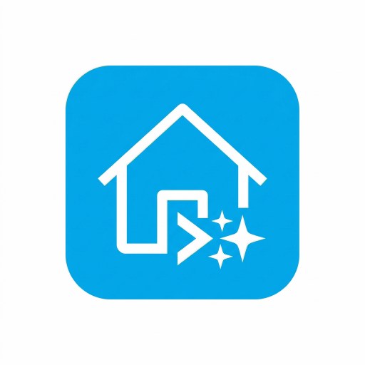
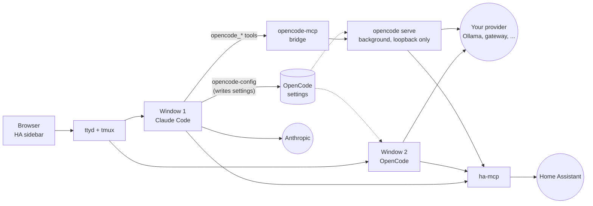

<div align="center">



### Claude Code in a browser terminal, inside Home Assistant

Write automations, debug YAML and control your instance in plain language —
without leaving the Home Assistant sidebar. [OpenCode](https://opencode.ai/)
runs beside it as a second agent, on any model you point it at.


[](https://my.home-assistant.io/redirect/supervisor_add_addon_repository/?repository_url=https%3A%2F%2Fgithub.com%2FWetDogNose%2Fhome-assistant-claude)

</div>

---

<div align="center">
  
</div>

---

## What you get

|  | Feature |
|:--:|---|
| 🖥️ | **Just Claude Code** — opens straight into Claude, no menus in the way |
| 🧩 | **OpenCode as a second agent** — in window 2 of the same terminal, on a local model, a gateway or any API endpoint; Claude can set it up and hand work to it. See [Two agents, one terminal](#two-agents-one-terminal) |
| 🤖 | **Automation API & Blueprints** — call Claude from Home Assistant automations over an authenticated HTTP endpoint, synchronously or as a background job; four blueprints ship with it |
| 🔔 | **Notifications** — Home Assistant tells you when Claude finishes a long task or stops to ask you something, optionally spoken |
| 📡 | **Entities** — `binary_sensor.claude_terminal_busy`, `sensor.opencode_status` and friends, for dashboards and automations |
| 📱 | **Usable from a phone** — a touch key bar adds Esc, Tab, Ctrl and the cursor keys that software keyboards lack |
| 📊 | **Dashboard Generator** — `ha-dashboard` generates Lovelace YAML dashboards by area/domain |
| 🕸️ | **Mesh & Battery Inspector** — `ha-mesh` scans Zigbee/Z-Wave/Matter signal quality and low batteries |
| 🐍 | **PyScript & Integration Scaffolding** — `ha-scaffold` generates custom components or PyScript Python automations |
| 🗣️ | **HA Assist Integration** — `ha-assist` queries Home Assistant Assist voice pipeline |
| 🧠 | **State History Search** — `ha-memory` queries state transitions and event history |
| 📱 | **Remote Messaging Bot** — `claude-bot` connects Telegram/Matrix/Discord webhooks to Claude |
| 🕒 | **Git Time-Machine** — `ha-git-backups` commits `/config` with 1-click `rollback` functionality |
| 🛡️ | **YAML Guardrails & Validation** — `ha-validate` checks config and auto-restores backups on syntax error |
| 📷 | **Camera Vision** — `ha-snapshot` captures camera frames for Claude visual analysis |
| ⏰ | **Autonomous Scheduler** — `claude-cron` runs prompts on a cron schedule, `daily 07:00` or `every 30m`, and posts HA notifications |
| 🪟 | **Several sessions** — `claude-session` runs more than one Claude at once; `claude-usage` reports token use |
| 📚 | **Built-in skills** — Claude already knows how to use every command above, so you can ask for the outcome |
| ⌨️ | **Quick-Bar & Diagnostics** — `ha-diagnose` for system health; `Ctrl+B h` popup menu for fast actions |
| 🏠 | **Knows your setup** — version, entities and apps are summarised for Claude automatically |
| 🔌 | **Controls Home Assistant** — bundled [ha-mcp](https://github.com/homeassistant-ai/ha-mcp) server for natural-language device and automation control |
| 🔁 | **Survives reloads** — tmux keeps your conversation alive across browser refreshes and navigation |
| 🔑 | **Log in once** — OAuth credentials persist across restarts and updates |
| 🐙 | **GitHub built in** — the `gh` CLI ships in the image; run `github-setup` and Claude can manage repos and push commits |
| 📦 | **Persistent packages** — `persist-install` keeps extra apk/pip tools across restarts |
| 📁 | **Broad file access** — `/config`, `/addon_configs` and `/share` are mounted |

---

## Install

Click the badge to open your own Home Assistant with this repository pre-filled:

[](https://my.home-assistant.io/redirect/supervisor_add_addon_repository/?repository_url=https%3A%2F%2Fgithub.com%2FWetDogNose%2Fhome-assistant-claude)

Or add it by hand:

1. In Home Assistant, go to **Settings** → **Apps** → **App Store**
2. Click the **⋮** menu in the top right and choose **Repositories**
3. Add this repository URL and click **Add**:

   ```text
   https://github.com/WetDogNose/home-assistant-claude
   ```

Either way, then:

4. Find **Claude Terminal (WetDogNose)** in the store and click **Install**
5. Start the app, then click **OPEN WEB UI** or open it from the sidebar
6. On first launch, follow the OAuth prompts to sign in to your Anthropic account

Images are pulled prebuilt from `ghcr.io/wetdognose`, so nothing is compiled on your Home Assistant machine.

> [!NOTE]
> **Installs alongside the original.** This fork's slug is `claude_terminal_wdn`,
> distinct from upstream's `claude_terminal`, so both can coexist. Each keeps its
> own `/data` — separate Claude login, separate history.

---

## Configuration

Works out of the box. Every option is labelled in the Home Assistant UI; the
full reference lives in **[DOCS.md](claude-terminal/DOCS.md)**.

| Option | Default | What it does |
|---|:--:|---|
| `auto_launch_claude` | `true` | Start Claude on open, or drop to a shell |
| `claude_auto_update` | `true` | Keep Claude Code current in the background |
| `claude_version` | `""` | Pin to `stable`, `latest` or `X.Y.Z` |
| `dangerously_skip_permissions` | `false` | ⚠️ Removes the confirmation step, for Claude **and** OpenCode |
| `claude_extra_args` | `""` | Extra flags for every launch |
| `enable_opencode` | `true` | OpenCode as a second agent in window 2 |
| `opencode_ha_tool_search` | `true` | Give OpenCode a search tool for Home Assistant instead of ~80 tools; about 70% smaller requests |
| `enable_opencode_mcp` | `true` | Let Claude hand work to OpenCode (third-party bridge, pinned by `opencode_mcp_version`) |
| `ha_smart_context` | `true` | Summarise your HA setup for both agents |
| `enable_ha_mcp` | `true` | Let the agents control Home Assistant |
| `ha_mcp_version` | `8.6.0` | Which ha-mcp release backs that connection |
| `notify_on_completion` | `true` | Notify when a long task finishes or Claude is waiting |
| `enable_ha_entities` | `true` | Publish busy / status / last-run entities |
| `enable_automation_api` | `true` | HTTP API for automations, port 8128, container network only |
| `require_ingress_user` | `false` | Restrict the terminal to signed-in users; read the security notes first |
| `git_user_name` / `git_user_email` | `""` | Commit identity for git |
| `persistent_apk_packages` | `[]` | apk packages reinstalled each boot |
| `persistent_pip_packages` | `[]` | pip packages reinstalled each boot |

These are the ones most people touch. All 29 are in the
[options table](claude-terminal/DOCS.md#options).

---

## Two agents, one terminal

Claude Code and OpenCode are separate programs sharing one tmux session. Each
has its own sign-in, settings, conversations and model. `Ctrl-b 1` is Claude,
`Ctrl-b 2` is OpenCode.



Everything that connects them runs from Claude to OpenCode:

- **Claude sets OpenCode up.** Ask "point OpenCode at my Ollama server" and
  Claude runs `opencode-config`. API keys go in on stdin and are stored in
  their own files, never in the config or on a command line.
- **Claude's MCP servers are passed on** to OpenCode at start, and again with
  `opencode-config mcp sync`. A server from `/config/.mcp.json` is passed on
  only once you have approved it in Claude.
- **Claude hands work over** through the `opencode_*` tools. The bridge
  starts a background `opencode serve` on first use, separate from window 2,
  listening inside the container only, and stops it when the Claude session
  ends.

OpenCode has no tool for calling Claude.

**Permissions are the add-on's, not OpenCode's.** OpenCode's own default is to
allow everything. The add-on writes a settings file that outranks yours: ask
before editing, running a command, fetching from the web or calling an MCP
tool; reading and searching do not ask. In window 2 you answer. On a task
handed over by Claude, Claude answers, after you approved the hand-over.
OpenCode also ignores any `opencode.json` or `.opencode/` in `/config`, because
it would run what it found there without asking.

The full walk-through, including where each settings file lives, is in
**[DOCS.md → OpenCode](claude-terminal/DOCS.md#opencode)**.

---

## Security

> [!CAUTION]
> **This app is powerful by design.** It runs as root, has read-write access
> to `/config`, `/addon_configs` and `/share`, and with MCP enabled can control
> devices and rewrite automations. That applies to both agents.

`dangerously_skip_permissions` removes the last human checkpoint. With it on, a
misunderstanding — or a prompt injection hidden in any file, issue or web page
Claude reads — can change your configuration or actuate devices without asking.
Leave it off unless you accept that trade-off. It applies to OpenCode too.

Any signed-in Home Assistant user can open the terminal unless you set
`require_ingress_user`; hiding the sidebar entry is not access control.

Full notes, including where credentials are stored and what lands in backups,
are in **[DOCS.md](claude-terminal/DOCS.md#security-notes)**. To report a
vulnerability, see **[SECURITY.md](SECURITY.md)**.

---

## Releasing

Merging to `main` ships **nothing**. Publishing is driven entirely by pushing a
`v*` tag, so a release is: bump the version, write the changelog, tag.

### 0. One-time: point `gh` at this repository

This repo has an `upstream` remote, and the GitHub CLI resolves a bare command
to the **parent** repository when it finds one. So `gh run list` reports on
upstream's runs, not yours — quietly, with plausible-looking output.

Fix it once:

```bash
gh repo set-default WetDogNose/home-assistant-claude
```

Otherwise pass `-R WetDogNose/home-assistant-claude` to every `gh` command
below. Note it is needed on **each** command in a pipeline, including any
nested `$(gh ...)` that supplies an argument.

### 1. Choose the version number

Versions are `<upstream base>-wdn.<n>`:

| Situation | Next version |
|---|---|
| Your own change, same upstream base | bump `n` → `2.5.1-wdn.2` |
| You merged a new upstream release | take their version, reset `n` → `2.6.0-wdn.1` |

Check what the current one is, and what has already shipped:

```bash
grep '^version:' claude-terminal/config.yaml
git tag -l 'v*' | sort -V | tail -5
```

`n` only ever goes up within a base. Never reuse a tag — the image tag is
derived from this version, and a reused tag silently changes what an already
published version means.

### 2. Bump and describe it

Both are required, and `release.yml` fails the tag if they disagree:

```bash
# claude-terminal/config.yaml
version: "2.5.1-wdn.2"

# claude-terminal/CHANGELOG.md — a section whose heading matches EXACTLY
## 2.5.1-wdn.2
```

The changelog section becomes the GitHub release notes, so write it for
someone deciding whether to update, not for yourself.

Open a PR with those two changes as normal — `main` is protected, and the
required checks must pass.

> [!NOTE]
> **Not every merge needs a release.** The Supervisor reads `config.yaml`,
> `DOCS.md` and `translations/` from the default branch, so changes to those
> take effect on merge — a store reload is enough. Only changes that land
> *inside the image* need a new version and tag:
>
> ```bash
> git diff --name-only $(git describe --tags --abbrev=0)..main -- \
>   claude-terminal/Dockerfile claude-terminal/run.sh claude-terminal/scripts/ \
>   claude-terminal/skills/ claude-terminal/opencode/ claude-terminal/web/ \
>   claude-terminal/blueprints/
> ```
>
> Non-empty means tag. Empty means reload the store and you are done.

### 3. Tag it

Once that PR is merged:

```bash
git checkout main && git pull
git tag v2.5.1-wdn.2 && git push origin v2.5.1-wdn.2
```

That single push runs the whole release: `release.yml` verifies the tag matches
`config.yaml`, extracts your changelog section and creates the GitHub release;
`publish-images.yml` builds both architectures, pushes them to GHCR, then
**pulls each image back and smoke-tests it**.

### 4. Confirm it is actually installable

The Supervisor pulls the tag matching `version:` verbatim — there is no
fallback to `latest`, so a missing image is a 404 at install time, not a
warning:

```bash
tok=$(curl -s "https://ghcr.io/token?scope=repository:wetdognose/amd64-addon-claude-terminal:pull&service=ghcr.io" | jq -r .token)
curl -s -H "Authorization: Bearer $tok" \
  https://ghcr.io/v2/wetdognose/amd64-addon-claude-terminal/tags/list | jq -r '.tags[]'
```

Your new version should be listed. In Home Assistant, the add-on then offers
the update normally.

To watch the release as it runs — `-R` on **both** commands, since the inner
one selects which run to watch:

```bash
gh run watch -R WetDogNose/home-assistant-claude \
  $(gh run list -R WetDogNose/home-assistant-claude --workflow="Publish Images" \
    --limit 1 --json databaseId --jq '.[0].databaseId')
```

> [!TIP]
> **If the publish fails**, fix the cause and re-run it against the existing tag
> rather than re-tagging:
> ```bash
> gh workflow run publish-images.yml -R WetDogNose/home-assistant-claude --ref v2.5.1-wdn.2
> ```
> Deleting and re-pushing a tag works, but anyone who already pulled the old
> one keeps it.

---

## Community tools

Built by others to extend Claude Terminal:

- **[ha-ws-client-go](https://github.com/schoolboyqueue/home-assistant-blueprints/tree/main/scripts/ha-ws-client-go)** by [@schoolboyqueue](https://github.com/schoolboyqueue) — lightweight Go CLI for the HA WebSocket API: entity states, service calls, automation traces, live monitoring.
- **[Claude HA Plugins](https://github.com/ESJavadex/claude-homeassistant-plugins)** by [@ESJavadex](https://github.com/ESJavadex) — Claude Code skills for Home Assistant: YAML validation, pre-save hooks, Lovelace checks.
- **[Claude Terminal Pro](https://github.com/ESJavadex/claude-code-ha)** by [@ESJavadex](https://github.com/ESJavadex) — a fork adding image paste, package management and auto-install.

---

## Support

Problems with **this fork** → [this repository's issues](https://github.com/WetDogNose/home-assistant-claude/issues).

Please don't raise fork-specific problems upstream: the upstream maintainer did
not build these images and cannot reproduce changes made here. If it reproduces
on upstream's add-on too, report it [there](https://github.com/heytcass/home-assistant-addons/issues) instead.

---

## Upstream & attribution

The Claude Terminal add-on is the work of
**[Tom Cassady (@heytcass)](https://github.com/heytcass)** and contributors, in
**[heytcass/home-assistant-addons](https://github.com/heytcass/home-assistant-addons)**.
All credit for the original add-on belongs there.

This fork exists so the images Home Assistant pulls are built from source you
can inspect here — the add-on runs as root with broad access, so it is worth
controlling what actually ships. It has since added features upstream does not
have: OpenCode, the Automation API, notifications, entities and scheduled
tasks among them. Both projects are MIT licensed.

Original work © Tom Cassady and contributors. See **[LICENSE](LICENSE)**.

The MIT licence covers the add-on code in this repository. Claude Code itself
is Anthropic software and is subject to
[Anthropic's Commercial Terms of Service](https://www.anthropic.com/legal/commercial-terms),
not to this licence.

<div align="center">
<sub>Built with Claude Code — development, debugging and documentation alike.</sub>
</div>
